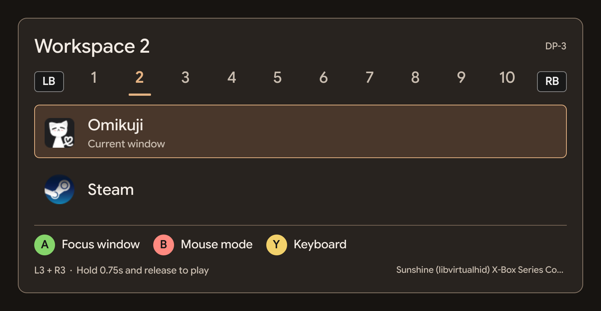

<h1 align="center">hyprcontroller</h1>

<p align="center">
  <strong>Control your Hyprland desktop with a gamepad.</strong><br>
  Switch workspaces, choose windows, move the mouse, and use your shell's on-screen keyboard.
</p>

<p align="center">
  <a href="#quick-start">Quick start</a> ·
  <a href="#controls">Controls</a> ·
  <a href="#configuration">Configuration</a> ·
  <a href="#troubleshooting">Troubleshooting</a> ·
  <a href="docs/VALIDATION.md">Testing</a> ·
  <a href="LICENSE">MIT license</a>
</p>

hyprcontroller started as a way to use a Hyprland PC over Moonlight without a mouse or working desktop shortcuts. It runs on the host PC and accepts both local gamepads and controllers forwarded by Sunshine.

Hold **L3 + R3**, then release everything to open the window picker. Choose a window or switch to mouse mode. Your controller stays in desktop mode until you hold the same buttons again and release them to resume gameplay.

<p align="center">
  
</p>

**Early testing stage.** Tested on one CachyOS / Hyprland setup across several games, using a local Xbox controller and Sunshine/Moonlight streaming. Other setups need testing; see [validation and known limits](docs/VALIDATION.md).

## What it does

- Switch workspaces and select windows from a compact picker.
- Use the left stick as a mouse, A/B as clicks, and the right stick to scroll.
- Keep desktop input captured after choosing a window, until you explicitly return to gameplay.
- Open an existing Quickshell on-screen keyboard with Y.
- Route gameplay through a virtual gamepad, with an optional launcher for games that bypass normal controller grabs.

The **initial activation presses can reach the game** before desktop mode opens. Neutral-state handoffs wait for released controls before changing modes. Games that read original devices directly may need the [isolated launcher](#if-a-game-still-reacts-in-desktop-mode).

## Quick start

Run hyprcontroller on the **Hyprland host PC**, which is the Sunshine machine when streaming through Moonlight.

### Requirements

| Requirement | Notes |
| --- | --- |
| Hyprland | Tested on 0.56.2; uses the Lua `hl.*` dispatch API |
| Quickshell (`qs`) | Tested on 0.2.1; use a build compatible with your installed Qt |
| Python 3.10+ and `python-evdev` | Current checks run on Python 3.14.8 and python-evdev 2.0.0 |
| Controller and `/dev/uinput` access | Your desktop user needs read/write access to the gamepad event node and `/dev/uinput` |
| Compatible Quickshell keyboard, optional | Tested with end4-pC / illogical-impulse; no keyboard is bundled |
| Bubblewrap (`bwrap`), optional | Needed only for the isolated game launcher |

On CachyOS or another Arch-based system, with Hyprland and Quickshell already installed:

```sh
sudo pacman -S --needed git python python-evdev
```

Use the equivalent packages on other distributions. Follow the [Quickshell installation guide](https://quickshell.org/docs/v0.2.0/guide/install-setup/) if you need to install it. After a Qt update, check Quickshell's startup output for build-compatibility warnings.

Verify the prerequisites without changing your configuration:

```sh
hyprctl version
qs --version
python -c 'import evdev; print("python-evdev is available")'
ls -l /dev/uinput
test -r /dev/uinput && test -w /dev/uinput && echo 'uinput access OK' || echo 'Check uinput access'
```

If `/dev/uinput` is missing or inaccessible, see [input permissions](#input-permissions).

### Run from the checkout

```sh
git clone https://github.com/Multex/hyprcontroller.git
cd hyprcontroller
./bin/hyprcontroller run --bridge
```

1. Connect a controller locally or start a Moonlight stream with gamepad forwarding enabled.
2. Hold L3 + R3 for one second, then release all buttons, sticks, and triggers.
3. Use LB/RB to change workspaces and the D-pad or left stick to choose a window.
4. Press A to focus that window and enter mouse mode, or B to go straight to mouse mode.
5. To resume playing, return to the game workspace, hold L3 + R3 again, and release everything.

The default hold duration is one second; `hold_seconds` can change it. Start the bridge before launching your game so the game can discover its virtual controller.

### Install a local launcher

The installer copies the app to `~/.local/share/hyprcontroller-overlay`, adds `~/.local/bin/hyprcontroller`, and creates `~/.config/hyprcontroller/overlay.json` if missing. It does not edit your Hyprland, Quickshell, or Sunshine configuration or enable autostart.

Stop any running instance, then create a verified configuration backup:

```sh
python scripts/backup.py
```

Replace `TIMESTAMP` below with the backup folder printed by the command:

```sh
python scripts/backup.py --verify ~/.local/state/hyprcontroller/backups/TIMESTAMP
python scripts/install.py install --backup ~/.local/state/hyprcontroller/backups/TIMESTAMP
~/.local/bin/hyprcontroller run --bridge
```

Backups live outside the checkout under `~/.local/state/hyprcontroller/backups/`. They can include Sunshine pairing state and credentials, so keep them private. Add `~/.local/bin` to your `PATH` to use the shorter `hyprcontroller` command.

## Controls

Labels follow the Xbox layout. Desktop mode keeps controller input captured even when the picker is hidden.

| Control | Window picker | Mouse mode |
| --- | --- | --- |
| Hold L3 + R3, then release | Resume gameplay | Resume gameplay |
| LB / RB | Previous / next workspace, once per press | Same |
| D-pad or left stick | Select a window | Left stick moves the cursor |
| Right stick | Unused | Scroll vertically and horizontally |
| A | Focus selected window and enter mouse mode | Left click; hold to drag |
| B | Hide picker and enter mouse mode | Right click |
| Start | Hide picker | Reopen picker |
| Y | Open keyboard and enter mouse mode | Toggle keyboard |

Release LB/RB before pressing again; holding a bumper does not keep switching. Workspace navigation includes normal workspaces on the chosen monitor and unassigned numbered workspaces 1 to 10. Special workspaces are excluded.

The picker also accepts arrow keys, Tab/Shift+Tab, Enter/Space, PageUp/PageDown for workspaces, Escape, and mouse clicks. The desktop cursor can cross monitors; the picker and corner badge use the selected monitor.

## Commands

From the checkout, replace `hyprcontroller` with `./bin/hyprcontroller`.

| Command | Action |
| --- | --- |
| `hyprcontroller run --bridge` | Start persistent desktop mode and virtual gamepad routing |
| `hyprcontroller status` | Show mode, controllers, virtual devices, and access errors as JSON |
| `hyprcontroller toggle` | Enter desktop mode or toggle the picker |
| `hyprcontroller resume` | Return to gameplay after controls are neutral |
| `hyprcontroller stop` | Stop the app and release its devices |
| `hyprcontroller game -- steam` | Launch Steam with an isolated controller-device view |

Plain `run` defaults to the older observe mode, where A/B close the overlay and mouse mode is unavailable. Use `run --bridge`, or set `input_mode` to `bridge`, for the controls described here.

### Running in the background

After testing manual startup, you can detach the installed app from a terminal:

```sh
mkdir -p "$HOME/.local/state/hyprcontroller"
nohup "$HOME/.local/bin/hyprcontroller" run --bridge >> "$HOME/.local/state/hyprcontroller/manual.log" 2>&1 < /dev/null &
```

Check it with `hyprcontroller status` and stop it with `hyprcontroller stop`. This command starts the app for the current desktop session; it does not enable automatic startup. Hyprland autostart entries and Sunshine session hooks are outside the tested installation path.

## Configuration

Settings live in `~/.config/hyprcontroller/overlay.json`. See [config.example.json](config.example.json), or use a separate file:

```sh
./bin/hyprcontroller run --bridge --config ./config.example.json
```

| Setting | Default | Meaning |
| --- | --- | --- |
| `input_mode` | `"observe"` | Set to `"bridge"` to omit the `--bridge` flag |
| `controller` | `"auto"` | Observe compatible gamepads, or select a device name or event path |
| `monitor` | `""` | Follow the focused monitor, or use a fixed output name such as `"DP-3"` |
| `activation_buttons` | `["BTN_THUMBL", "BTN_THUMBR"]` | evdev buttons held together to enter or leave desktop mode |
| `hold_seconds` | `1.0` | Gesture duration, from 0.05 to 5 seconds |
| `dead_zone` | `0.24` | Neutral threshold; must be below `direction_threshold` |
| `direction_threshold` | `0.55` | Stick deflection required to navigate windows, up to 1 |
| `repeat_delay` / `repeat_interval` | `0.35` / `0.12` | Held-direction timing in seconds; does not repeat LB/RB |
| `pointer_speed` | `900.0` | Maximum cursor speed in pixels/second, from 50 to 3000 |
| `scroll_speed` | `8.0` | Maximum scroll ticks/second, from 1 to 30 |
| `keyboard_config` | `"end4-pC"` | Running Quickshell configuration that provides keyboard IPC |

Device names are usually more stable than `/dev/input/event*` numbers across reconnects.

## Keyboard integration

Y controls an existing Quickshell keyboard through an [IPC handler](https://quickshell.org/docs/v0.2.0/types/Quickshell.Io/IpcHandler/) named `osk`, with `open()`, `toggle()`, and `close()` methods. Check your shell's targets with:

```sh
qs ipc -c end4-pC show
```

Set `keyboard_config` to that shell's configuration name. Focus a text field, press Y, then point at keys with the left stick and click with A. The app closes the keyboard when reopening the picker, returning to gameplay, or shutting down.

Workspace switching and mouse control work without a keyboard provider. The tested shell keyboard can clip on displays narrower than about 816 logical pixels; its layout and monitor placement belong to that shell.

## If a game still reacts in desktop mode

The bridge grabs the source controller and keeps its virtual gamepad neutral during desktop mode. Some games read raw HID or USB devices directly and can bypass that grab.

For those games, exit Steam and running games, start the bridge, connect all needed controllers, then launch Steam through:

```sh
hyprcontroller game -- steam
```

For a standalone game:

```sh
hyprcontroller game -- /path/to/game [arguments]
```

This requires Bubblewrap; on Arch, install `bubblewrap`. The launcher hides original input, HID, USB, and uinput devices while exposing the virtual gamepads. It leaves your filesystem accessible and is not a security sandbox.

Restart Steam or the game if you restart the bridge or need to expose a newly created virtual controller to an isolated session.

## Troubleshooting

| Symptom | Check |
| --- | --- |
| L3 + R3 does nothing | Hold for the configured duration and release everything. Check `controllers` and `access_errors` in `hyprcontroller status`. |
| Controller reconnects but the picker takes a moment to open | Wait for controller discovery, check `status`, then retry the gesture. Reconnect recovery has been reported working through Sunshine. |
| Stuck on “Release controls” | A button, trigger, or stick may still be held. Check stick drift against `dead_zone`; use `hyprcontroller stop` to release capture. |
| Y does nothing | Check `keyboard_config` and confirm the shell exposes `osk`. |
| Game still receives desktop input | Try the isolated launcher described above. |
| Quickshell reports a Qt build mismatch | Rebuild or reinstall your Quickshell package against the installed Qt, following its package instructions. |

### Input permissions

Run the app as your desktop user. If `/dev/uinput` is missing, loading the kernel module may be necessary:

```sh
sudo modprobe uinput
```

If `status` reports access errors, inspect the listed gamepad node. Replace `eventN` below with its actual path:

```sh
ls -l /dev/uinput /dev/input/eventN
getfacl /dev/uinput /dev/input/eventN
```

`getfacl` is supplied by the `acl` package on CachyOS and Arch. Use your distribution's udev/session policy to grant read/write access to **joystick event nodes** and `/dev/uinput`. Avoid granting access to all input devices or running hyprcontroller as root. The installer does not add permission rules.

If an application component stops responding, the heartbeat and shutdown paths release owned devices. After a crash, check `status` and the log; games may need restarting to discover recreated virtual controllers.

## Updates and rollback

From the checkout used to install the app:

```sh
python scripts/install.py update
python scripts/install.py rollback --dry-run
python scripts/install.py rollback
```

Updates save a verified backup and preserve your configuration. The installer tracks owned files in `~/.local/state/hyprcontroller/install.json` and refuses to overwrite later edits. Rollback removes unchanged installed files; `--keep-modified` retains edited files. Start the app again manually after an update.

## TODO

- [ ] Add a built-in on-screen keyboard without requiring another shell configuration.
- [ ] Support D-pad and stick navigation between keys, with A to type and Y to open or close the keyboard.
- [ ] Include Shift, Backspace, Space, and Enter.
- [ ] Make the keyboard fit desktop displays and phone streams.
- [ ] Add a desktop app with settings and an option to close to the system tray.

## Development

The Python [backend](hyprcontroller/) handles input, mode transitions, the virtual gamepad bridge, and Hyprland commands. The standalone [Quickshell UI](ui/) communicates with it through newline-delimited JSON. The pointer uses a quadratic stick response and fractional motion accumulation; Hyprland state uses batched queries and an event-driven cache.

Controller button labels, colors, and shapes live in [ControllerLayout.js](ui/ControllerLayout.js). Changing those hints does not change input bindings. See [DESIGN.md](docs/DESIGN.md) for the layout decisions.

```sh
python -m unittest discover -s tests -v
python scripts/ui_smoke.py
python scripts/render_preview.py /tmp/hyprcontroller-preview.png --width 640 --height 360
```

The offscreen UI checks and renderer additionally need PySide6. They use sample windows without touching controllers or workspaces. Close Steam and games before running live virtual-controller tests; [VALIDATION.md](docs/VALIDATION.md) describes those separately.

## License

[MIT](LICENSE). Copyright © 2026 Multex.
